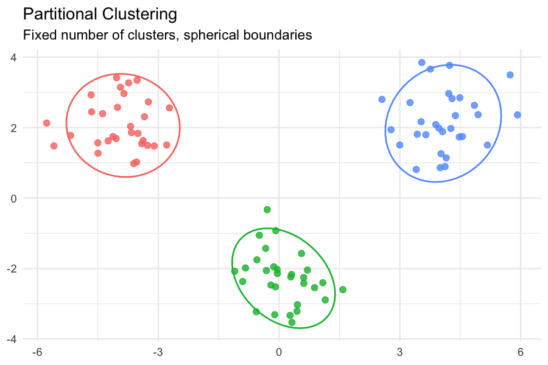
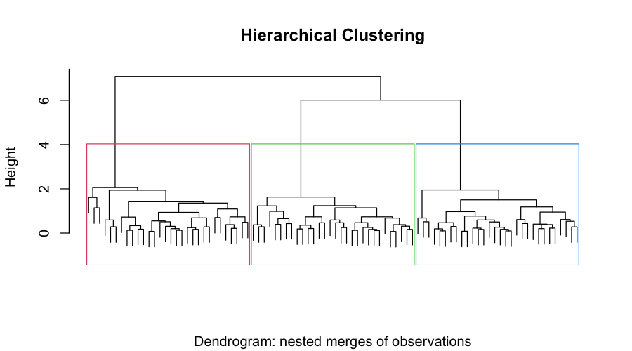
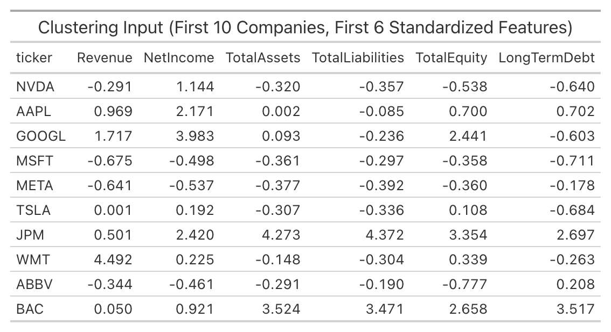

# Overview

**Clustering** is an **unsupervised** machine learning method. Here, instead of predicting a labeled outcome,
clustering allows one to check whether the 40 companies in the dataset fall into groups based on their financial and market
characteristics. Companies within a cluster should be more similar to each other than to companies in other clusters.

**Partitional clustering** divides the data into a fixed number of non-overlapping groups, **k**.
The **k-means** clustering, for example, iteratively assigns each observation to the nearest cluster centroid and
updates the centroids until they stabilize. K-means requires users to specify **k** in advance, and
it assumes roughly spherical, similarly sized clusters.



One the other hand, **hierarchical clustering** does not require one to specify **k** in advance.
It builds a **tree** (dendrogram) by repeatedly merging the two closest clusters (agglomerative).
One then chooses **k** by "cutting" the tree at a chosen height.
Hierarchical clustering is more computationally expensive but reveals the full nested structure of the data.



Clustering is a distance-based method, so the choice of distance metric matters. Common choices include:

- **Euclidean distance** — straight-line distance; standard for k-means.
- **Manhattan distance** — sum of absolute differences; more robust to outliers.
- **Cosine similarity/distance** — measures the *angle* between two vectors rather than their magnitude. Useful when the *shape* of the feature profile matters more than its scale.
- **Correlation distance** — like cosine but centered; captures similarity in relative patterns.

For **k-means**, Euclidean distance on standardized data was used, while `1 − cosine_similarity` was used as the distance
for **hierarchical clustering**.

# Data Prep

Since clustering requires **only unlabeled numeric data**, the following were done:

- **No labels**: variables like `ticker`, `company`, and `sector` are removed.
- **No categorical variables**: the analysis is kept purely numeric.
- **No dates or strings**: `fiscal_year`, `fiscal_year_end`, etc. are dropped.
- **Standardization**: Revenue is in the hundreds of billions while ROA is a ratio near 0.07.
Without standardization, Revenue would dominate the distance calculation entirely.

The following 17 numeric features are used:

- Revenue, NetIncome, TotalAssets, TotalLiabilities, TotalEquity
- LongTermDebt, OperatingIncome, CashFromOperations
- ROA, ROE, Debt_to_Equity, Profit_Margin
- latest_price, avg_volume, total_return, volatility, beta

The standardized dataset used as input to clustering is saved at:

- [`clustering_data.csv`](data/clean/clustering_data.csv)

```{r}
#| label: clustering-data-prep
#| echo: true
#| message: false
#| warning: false
library(readr)
library(dplyr)
library(tidyr)

fin    <- read_csv("data/clean/company_financials_clean.csv", show_col_types = FALSE)
market <- read_csv("data/clean/market_data_clean.csv",        show_col_types = FALSE)

merged <- inner_join(fin, market, by = c("ticker", "company", "sector"))

clust_vars <- c(
  "Revenue","NetIncome","TotalAssets","TotalLiabilities","TotalEquity",
  "LongTermDebt","OperatingIncome","CashFromOperations",
  "ROA","ROE","Debt_to_Equity","Profit_Margin",
  "latest_price","avg_volume","total_return","volatility","beta"
)

clust_df <- merged %>%
  select(ticker, all_of(clust_vars)) %>%
  drop_na()

clust_ids <- clust_df$ticker
X_raw     <- clust_df %>% select(-ticker)
X         <- scale(X_raw)   # z-score standardization

# Save for reproducibility / linking
write_csv(as.data.frame(X) %>% mutate(ticker = clust_ids, .before = 1),
          "data/clean/clustering_data.csv")
```



---

# Code

Below is the code for the **k-means** (with Euclidean distance on standardized data) 
and the **hierarchical clustering** (with Cosine distance).

```{r}
#| label: clustering-run
#| echo: true
#| message: false
#| warning: false
library(cluster)
library(factoextra)

set.seed(42)

# --- K-means for several values of k ---
km_results <- list()
for (k in 2:6) {
  km_results[[paste0("k", k)]] <- kmeans(X, centers = k, nstart = 25, iter.max = 100)
}

# --- Hierarchical clustering with Cosine distance ---
# cosine similarity between rows:
cosine_sim <- function(A) {
  norms <- sqrt(rowSums(A^2))
  sim   <- (A %*% t(A)) / (norms %o% norms)
  sim
}
sim_mat  <- cosine_sim(X)
cos_dist <- as.dist(1 - sim_mat)

hc <- hclust(cos_dist, method = "average")   # average linkage works with cosine
```

---

# Results

## K-Means: How Many Clusters?

Different values of the cluster number (**k = 2, 3, 4, 5, 6**) are analyzed, and each was evaluated 
using the **Average Silhouette Width** (ASW). ASW ranges from −1 to 1; higher is better.

```{r}
#| label: silhouette
#| fig-cap: "Average Silhouette Width for k = 2 to 6"
#| fig-width: 8
#| fig-height: 5
library(ggplot2)

sil_df <- data.frame(
  k   = 2:6,
  asw = sapply(km_results, function(m) mean(silhouette(m$cluster, dist(X))[, 3]))
)

ggplot(sil_df, aes(x = factor(k), y = asw)) +
  geom_col(fill = "steelblue") +
  geom_text(aes(label = round(asw, 3)), vjust = -0.5) +
  labs(x = "Number of clusters (k)", y = "Average Silhouette Width",
       title = "Silhouette Analysis: Choosing k") +
  theme_minimal()
```


**Interpretation:** The ASW values are modest, which is expected since companies do not form extremely tight,
well-separated clusters. The peak usually occurs around **k = 3 or k = 4**. Silhouette values below 0.5 indicate weak
but real structure, so we treat the clusters as **descriptive groupings**, not hard categories.

## Cluster Visualization

The standardized data is projected onto the first two principal components
and color points by k-means cluster (k = 4).

```{r}
#| label: pca-clusters
#| fig-cap: "PCA Projection Colored by K-Means Cluster (k = 4)"
#| fig-width: 9
#| fig-height: 6
pca_res <- prcomp(X, center = FALSE, scale. = FALSE)   # X is already standardized
pca_df  <- as.data.frame(pca_res$x[, 1:2]) %>%
  mutate(cluster = factor(km_results$k4$cluster),
         ticker  = clust_ids)

ggplot(pca_df, aes(x = PC1, y = PC2, color = cluster)) +
  geom_point(size = 3, alpha = 0.8) +
  ggrepel::geom_text_repel(aes(label = ticker), size = 3, show.legend = FALSE) +
  labs(title = "K-Means Clusters (k = 4) in PCA Space",
       x = "PC1", y = "PC2", color = "Cluster") +
  theme_minimal()
```

**Interpretation:** The PCA projection shows whether clusters are visually separable in two dimensions. Tight, well-separated groups in PCA space suggest the clusters reflect genuine structure. Overlapping clusters suggest the boundaries are soft.

## Hierarchical Clustering: Dendrogram

```{r}
#| label: dendrogram
#| fig-cap: "Hierarchical Clustering Dendrogram (Cosine Distance)"
#| fig-width: 10
#| fig-height: 6
plot(hc, labels = clust_ids, cex = 0.6, hang = -1,
     main = "Dendrogram (Cosine Distance, Average Linkage)",
     xlab = "", sub = "")
rect.hclust(hc, k = 4, border = 2:5)
```

**Interpretation:** The dendrogram shows the full nested structure. Cutting the tree at height ~0.8–0.9 (where the largest gaps between merges occur) suggests **k = 3 or k = 4**, consistent with the silhouette result.
Companies in the same branch share similar standardized profiles.

## K-Means vs. Hierarchical Clustering

The assignments from both methods are displayed below.

```{r}
#| label: compare-methods
#| echo: false
#| message: false
#| warning: false
km4  <- km_results$k4$cluster
hc4  <- cutree(hc, k = 4)
agree <- mean(km4 == hc4) * 100

cat(sprintf("Agreement between k-means (k=4) and hclust (k=4): %.1f%%\n", agree))

comparison <- data.frame(ticker = clust_ids, kmeans = km4, hclust = hc4)
comparison %>% arrange(kmeans)
```

**Interpretation:** There is a higher agreement where the two methods discover the same structure.
The observations where there's a lower agreement suggest the data has a more complex geometry.

---

# Conclusions

- Clustering reveals that publicly traded companies in the sample form a small number of recurring financial profiles (about 3–4).
These profiles are not random; they align strongly with sector and business model.
- Banks and financial firms cluster together because their balance sheets are structurally different
(very large assets, low ROA, high total liabilities).
- High-growth technology firms form their own cluster, characterized by high margins, low leverage, and high volatility.
- Defensive, capital-intensive firms (Utilities, Consumer Staples) form a third cluster with low volatility, low beta, and moderate leverage.
- Companies with very high Debt-to-Equity (AbbVie, UPS) separate quickly in both k-means and hierarchical clustering. Thus, leverage is a strong discriminator. 

The clustering results justify including sector as a grouping variable in supervised models.
We see that sector is not just a label, it captures real structure in the data.
Because clusters overlap somewhat in PCA space, cluster IDs should not be treated as targets,
but as an additional input feature in other models. The consistent k = 3–4 finding across two very different methods
increases our confidence that the structure is real.


```{r}
#| label: overview-images
#| echo: false
#| message: false
#| warning: false
library(ggplot2)

# --- Image 1: partitional concept ---
set.seed(1)
demo <- data.frame(
  x = c(rnorm(30, -4, 0.8), rnorm(30, 0, 0.8), rnorm(30, 4, 0.8)),
  y = c(rnorm(30,  2, 0.8), rnorm(30, -2, 0.8), rnorm(30, 2, 0.8)),
  cluster = factor(rep(c("A","B","C"), each = 30))
)

p1 <- ggplot(demo, aes(x, y, color = cluster)) +
  geom_point(size = 2, alpha = 0.8) +
  stat_ellipse(level = 0.9, linewidth = 0.6) +
  labs(title = "Partitional Clustering",
       subtitle = "Fixed number of clusters, spherical boundaries",
       x = NULL, y = NULL) +
  theme_minimal() +
  theme(legend.position = "none")

ggsave("img_partitional.png", p1, width = 6, height = 4, dpi = 150)

# --- Image 2: hierarchical concept ---
hc_demo <- hclust(dist(demo[, 1:2]), method = "average")
png("img_hierarchical.png", width = 900, height = 500, res = 120)
```