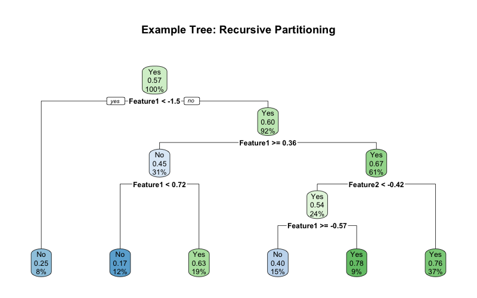
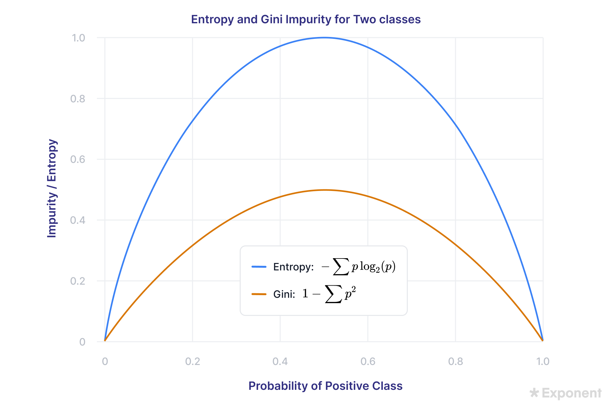
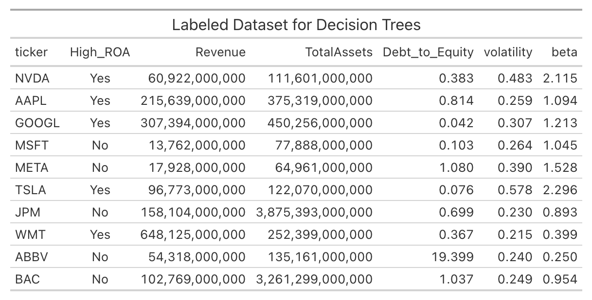
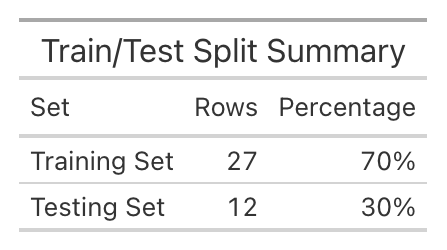

```{r}
#| label: setup-dt
#| echo: false
#| message: false
#| warning: false
library(readr)
library(dplyr)
library(rpart)
library(rpart.plot)
library(caret)
library(ggplot2)
library(reshape2)

# Load and clean data ONCE for the whole document
train_df <- read_csv("data/clean/dt_train.csv", show_col_types = FALSE) %>% select(-ticker)
test_df  <- read_csv("data/clean/dt_test.csv",  show_col_types = FALSE) %>% select(-ticker)

train_df$High_ROA <- as.factor(train_df$High_ROA)
test_df$High_ROA  <- as.factor(test_df$High_ROA)
```

# Overview

**Decision Trees** are a supervised machine learning method used for both classification and regression.
They split the data into subsets based on a series of simple yes/no questions about the features
(e.g., "Is Revenue greater than $50 billion?"). The result is a tree-like flowchart where each internal node
represents a test on a feature, each branch represents the outcome of that test, and each leaf node represents a
final prediction (like "High ROA" or "Low ROA").

Decision trees are widely used in finance for credit scoring, loan approval, and risk assessment.
Their main advantage is that one can read the exact rules the model used to make a decision.



## How Trees Are Built: GINI, Entropy, and Information Gain

To build a tree, the algorithm must decide which feature to split on at each step, and at what threshold.
It evaluates every possible split and chooses the one that best separates the classes.
To measure "best," it uses **impurity metrics** like GINI and Entropy, and **Information Gain** to compare the
before-and-after states.

**Entropy** measures the disorder of a node. If a node contains a 50/50 mix of "Yes" and "No",
the entropy is at its maximum (1.0). If a node is 100% "Yes" or 100% "No", the entropy is 0 (pure).
**GINI Impurity** measures the probability of misclassifying a randomly chosen element.
Similar to entropy, GINI is 0 when a node is pure, and higher when classes are mixed.
**Information Gain** is the reduction in entropy (or GINI) achieved by a split.
The algorithm chooses the split that maximizes Information Gain.



For any continuous variable (like Revenue), there are infinitely many possible split points.
One could split at $50B, or $50.1B, or $50.0001B. Even for categorical splits, there are infinitely many possible
tree structures depending on which features one chooses, in what order, and how deep the tree grows.
Because the tree can keep growing until every leaf is pure (or contains 1 company),
there are infinite ways to build a tree. **Pruning** is thus used to find a good, finite tree that generalizes well.

# Data Prep

The `High_ROA` label from the Naïve Bayes tab (1 if a company's ROA is above the median, 0 otherwise) are reused. 

Unlike Naïve Bayes, Decision Trees can handle continuous numeric features well.
`Revenue`, `TotalAssets`, `Debt_to_Equity`, `volatility`, and `beta` are used. The data is split 
into a **Training Set (70%)** and a **Testing Set (30%)**. These sets must be **disjoint** to prevent data leakage.

The full labeled dataset is here: [`decision_tree_data.csv`](data/clean/decision_tree_data.csv)





# Code

The R code below uses the `rpart` package to train the Decision Tree and `rpart.plot` to visualize it.

```{r}
#| label: dt-code
#| echo: true
#| eval: false
#| message: false
#| warning: false
library(readr)
library(dplyr)
library(rpart)
library(rpart.plot)
library(caret)

train_df <- read_csv("data/clean/dt_train.csv", show_col_types = FALSE)
test_df  <- read_csv("data/clean/dt_test.csv",  show_col_types = FALSE)
```

# Results

Three different trees are trained by varying the **Complexity Parameter (`cp`)**.
A smaller `cp` allows the tree to grow deeper (more complex), while a larger `cp` prunes the tree (simpler).

## Tree 1: Default Complexity (cp = 0.01)

```{r}
#| label: tree1
#| echo: false
#| message: false
#| warning: false
#| fig-cap: "Decision Tree 1: Default rpart settings"
#| fig-width: 8
#| fig-height: 5
tree1 <- rpart(High_ROA ~ ., data = train_df, method = "class")
rpart.plot(tree1, main = "Tree 1: Default (cp = 0.01)", extra = 104)
```

## Tree 2: Pruned Tree (cp = 0.05)

```{r}
#| label: tree2
#| echo: false
#| message: false
#| warning: false
#| fig-cap: "Decision Tree 2: Heavily pruned (simpler)"
#| fig-width: 8
#| fig-height: 5
tree2 <- rpart(High_ROA ~ ., data = train_df, method = "class", cp = 0.1)
rpart.plot(tree2, main = "Tree 2: Pruned (cp = 0.1)", extra = 104)
```

## Tree 3: Deep Tree (cp = 0.001)

```{r}
#| label: tree3
#| echo: false
#| message: false
#| warning: false
#| fig-cap: "Decision Tree 3: Deep tree (more complex)"
#| fig-width: 8
#| fig-height: 5
tree3 <- rpart(High_ROA ~ ., data = train_df, method = "class", 
               cp = 0.001, minsplit = 2, minbucket = 1)
rpart.plot(tree3, main = "Tree 3: Deep (cp = 0.001, minbucket = 1)", extra = 104)
```
Because our dataset is small, the default rpart settings (minsplit = 20) prevent the tree from growing very deep.

## Confusion Matrix and Accuracy

The trees are evaluated on the testing set:

```{r}
#| label: dt-cm
#| echo: false
#| message: false
#| warning: false
predictions <- predict(tree3, test_df, type = "class")
cm <- confusionMatrix(predictions, test_df$High_ROA)

cm$table
```

```{r}
#| label: dt-accuracy
#| echo: false
cat(sprintf("Accuracy: %.1f%%\n", cm$overall["Accuracy"] * 100))
```

```{r}
#| label: dt-cm-plot
#| fig-cap: "Confusion Matrix Heatmap"
#| fig-width: 6
#| fig-height: 5
#| echo: false
#| warning: false
library(ggplot2)
library(reshape2)

cm_df <- as.data.frame(cm$table)
colnames(cm_df) <- c("Prediction", "Reference", "Freq")

ggplot(data = cm_df, mapping = aes(x = Reference, y = Prediction, fill = Freq)) +
  geom_tile(color = "white") +
  geom_text(aes(label = Freq), size = 6, color = "white") +
  scale_fill_gradient(low = "steelblue", high = "firebrick") +
  labs(title = "Confusion Matrix: Decision Tree",
       x = "Actual", y = "Predicted") +
  theme_minimal()
```

The confusion matrix above shows the model's performance on the 30% hold-out test set.
The model achieved an accuracy of 58.3%. It correctly classified 4 companies as having High ROA and 3 companies as having Low ROA. 
The limited size of our dataset means that a single Decision Tree will always be a bit unstable as seen from the confusion matrix.

# Conclusions
1. Unlike Naive Bayes or PCA, one can trace a decision tree by hand.
2. The trees naturally handle combinations of features (e.g., High Assets AND Low Debt) that linear models or Naïve Bayes might struggle with.
3. With only 40 companies, a deep tree will perfectly memorize the training data but perform poorly on the test set. This was evident in the result.
4. The financial variables need not to be binned into Low/Medium/High this time. Trees found their own optimal cutoffs (e.g., "Revenue > 158,000,000,000").

The trees reveal that **Total Assets**, **Debt-to-Equity**, and **Revenue** are usually the strongest
early splitters for predicting High vs. Low ROA.
This aligns with the EDA finding that capital structure and scale heavily influence profitability.