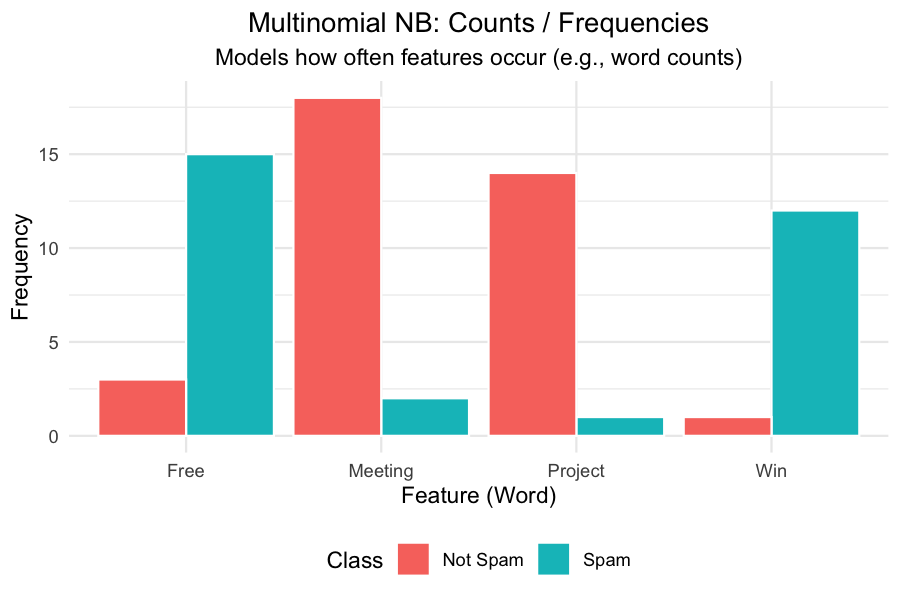
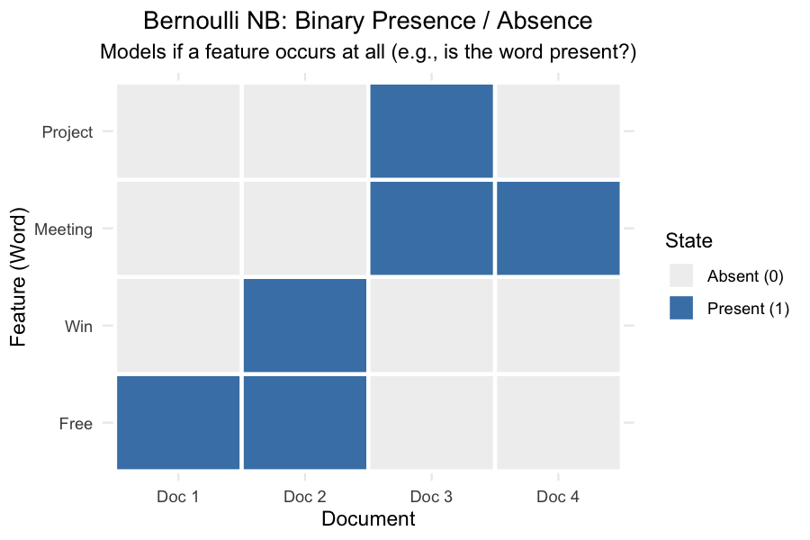
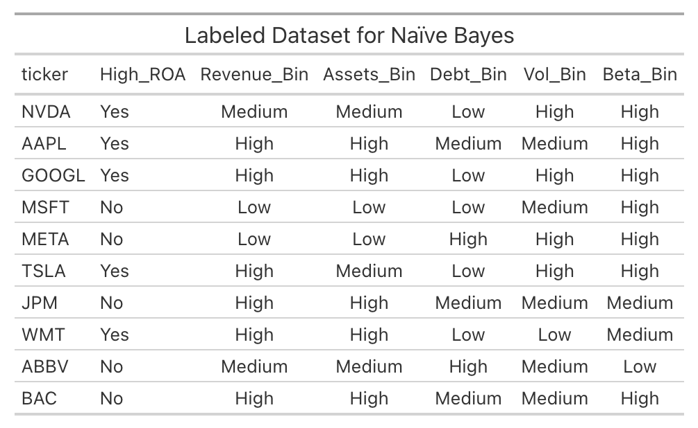
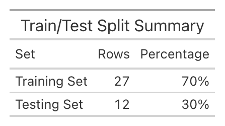
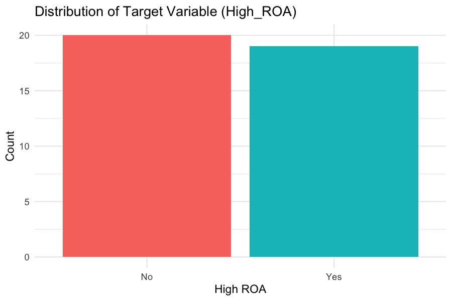

# overview

**Naive Bayes** is a supervised machine learning algorithm based on Bayes' Theorem.
It is used for predicting which category a new observation belongs to based on its features.
Naive Bayes is simple and effective. It is widely used in spam filtering, sentiment analysis, and medical diagnosis.

The "naive" part of the name comes from the assumption that all features are conditionally independent of each other given
the target class. In reality, features are rarely perfectly independent
(e.g., Revenue and Total Assets are highly correlated), but the algorithm often performs well even when this assumption
is violated.

Naive Bayes calculates the probability of each class given the input features and assigns the observation to the class
with the highest probability.

## Multinomial vs. Bernoulli Naive Bayes

**Multinomial Naive Bayes** is designed for discrete data that represents **counts or frequencies**.
It is the standard version used in text classification, where the features are the frequencies of words in a document.
In this project, it is applied to categorical data.



**Bernoulli Naive Bayes** is designed for **binary data** (0 or 1, True or False).
It models the presence or absence of a feature. For example, in spam filtering, it would look at whether specific words
(like "free" or "win") appear in an email, rather than how many times they appear.



# Data Prep

Supervised learning requires labeled data.
For Naive Bayes, the data is first converted into a format the algorithm can use.

- **Labeled Data:** A binary target variable, `High_ROA`, is first created. If a company's ROA is above the median, it is labeled "Yes"; otherwise, it is labeled "No".
- **Categorical Features:** Standard Multinomial Naïve Bayes works with discrete categories.
The continuous features (Revenue, Assets, Debt, Volatility, Beta) are grouped into three categories: Low, Medium, and High.
- **Train/Test Split:** To properly evaluate the model, the data are splitted into:
  - **Training Set (70%):** The model learns the probabilities from this data.
  - **Testing Set (30%):** The model is evaluated on this unseen data to measure how well it generalizes.

## The Labeled Dataset

The full labeled dataset is stored at: [`naive_bayes_data.csv`](data/clean/naive_bayes_data.csv).



## Train/Test Split

70% of the companies are randomly assigned to the training set while the remaining percentage is used for testing.
The summary is shown below:





# Code

The R code below trains a Multinomial Naive Bayes classifier using the `e1071` package.

```{r}
#| label: nb-code
#| echo: true
#| message: false
#| warning: false
library(readr)
library(dplyr)
library(e1071)
library(caret)

# Load the disjoint sets
train_df <- read_csv("data/clean/nb_train.csv", show_col_types = FALSE)
test_df  <- read_csv("data/clean/nb_test.csv",  show_col_types = FALSE)

# Ensure target is a factor for classification
train_df$High_ROA <- as.factor(train_df$High_ROA)
test_df$High_ROA  <- as.factor(test_df$High_ROA)

# Train the model (excluding the ticker column)
nb_model <- naiveBayes(High_ROA ~ . - ticker, data = train_df)

# Predict on the test set
predictions <- predict(nb_model, test_df)

# Confusion Matrix
cm <- confusionMatrix(predictions, test_df$High_ROA)
```

# Results

The model is evaluated using a **Confusion Matrix**, which shows how many companies were correctly and incorrectly classified.

```{r}
#| label: nb-cm
#| echo: false
#| message: false
#| warning: false
cm$table
```

```{r}
#| label: nb-accuracy
#| echo: false
cat(sprintf("Accuracy: %.1f%%\n", cm$overall["Accuracy"] * 100))
```

## Visualizing the Confusion Matrix

```{r}
#| label: nb-plot
#| fig-cap: "Confusion Matrix Heatmap"
#| fig-width: 6
#| fig-height: 5
#| echo: false
#| warning: false
library(ggplot2)
library(reshape2)

cm_df <- as.data.frame(cm$table)
colnames(cm_df) <- c("Prediction", "Reference", "Freq")

ggplot(data = cm_df, mapping = aes(x = Reference, y = Prediction, fill = Freq)) +
  geom_tile(color = "white") +
  geom_text(aes(label = Freq), size = 6, color = "white") +
  scale_fill_gradient(low = "steelblue", high = "firebrick") +
  labs(title = "Confusion Matrix: Naïve Bayes",
       x = "Actual (Reference)",
       y = "Predicted") +
  theme_minimal()
```


The confusion matrix shows that the model correctly identified 5 companies with High ROA and 4 companies with Low ROA. 

# Conclusions
1. By grouping the continuous financial variables and defining a binary target (`High_ROA`),
the exploratory dataset was transformed into a supervised learning problem.
2. Naive Bayes handles small datasets well, but its independence assumption
is severely tested. Here, Revenue and Assets are highly correlated, which violates the core "naïve" assumption.
3. Splitting 40 companies into 28 training and 12 testing instances leaves very little data to learn from, making the model highly sensitive to the specific random split.

The model shows that financial characteristics do contain signal about a company's profitability.
However, because standard Naive Bayes struggles with continuous data,
more advanced methods like decision trees are likely to perform better on this specific dataset.
Regardless, Naive Bayes is a great starting point for classification.