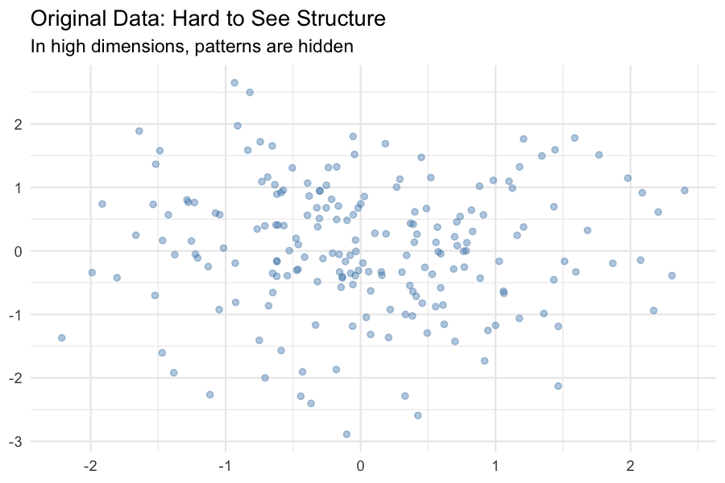
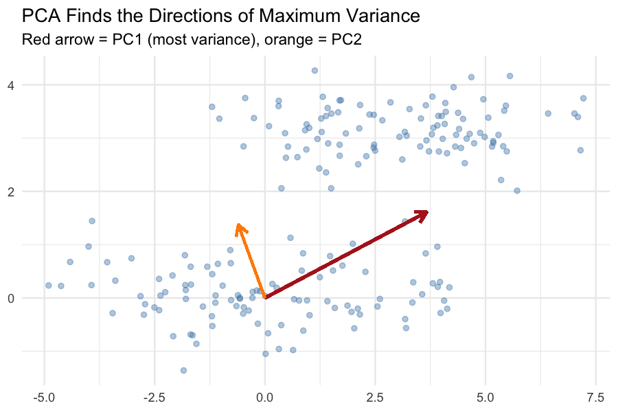
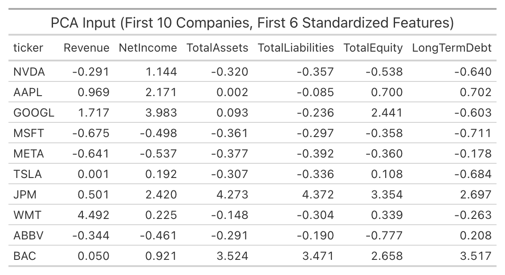

# Overview

**Principal Component Analysis (PCA)** is a dimensionality-reduction technique that transforms a set of
correlated variables into a smaller set of uncorrelated variables called **principal components**.
Each principal component is a linear combination of the original features, and the components are ordered so
that the first captures the most variance in the data, the second captures the next most, and so on. Like clustering, PCA is **unsupervised**. It does not use any outcome or label.
It reveals which combinations of features carry the most information and how the observations relate to one another
in a lower-dimensional space.

At the heart of PCA lies the covariance (or correlation) matrix of the standardized data. This matrix summarizes how each pair of variables varies together.
An **eigenvector** of this matrix is a direction in feature space that is unchanged (up to scaling) when the covariance
matrix is applied to it. In PCA terms, eigenvectors are the directions of the principal components.
The corresponding **eigenvalue** measures how much variance of the data lies along that direction.
The largest eigenvalue corresponds to the first principal component (PC1), the second largest to PC2, and so on.
Because eigenvectors are orthogonal (perpendicular), the principal components are uncorrelated with each other,
where each captures a distinct dimension of variation.

Mathematically, PCA solves:

$$
\Sigma v_i = \lambda_i v_i
$$

where $\Sigma$ is the covariance matrix, $v_i$ is the $i$-th eigenvector, and $\lambda_i$ is its eigenvalue. The **loading** of each original variable on a component is given by the corresponding entry of the eigenvector.

**Dimensionality reduction** means replacing a large set of features with a smaller set that retains most of the information.
In PCA, we keep the first $k$ principal components, which together explain most of the total variance.
This reduces the number of dimensions without discarding the underlying signal.

High-dimensional data is difficult to work with for several reasons:

- **Visualization is impossible** beyond three dimensions. PCA lets us project data onto two or three axes
we can actually plot.
- **Distance calculations become unreliable.** In high dimensions, all points tend to be roughly equidistant.
- **Models overfit more easily.** More features than observations lead to unstable estimates.
Reducing dimensions can improve generalization.
- **Collinearity is common.** In our dataset, Revenue, Net Income, and Total Assets are strongly correlated.
PCA collapses these into a single component that captures "size," removing redundancy.
- **Noise accumulates.** With many features, noise can dominate the signal..





In this section, we do the following:

1. **Reduce** our 17 financial and market features into a small number of components that retain most of the variance.
2. **Visualize** the 40 companies in a two-dimensional PCA space to see whether sectors separate naturally.
3. **Interpret** the components by examining their loadings

---

# Data Prep

PCA requires **numeric, standardized** data. All features used are be numeric. There are no missing values since PCA cannot handle `NA`s.
All 40 companies have complete financial and market data after our earlier imputation.
We z-score every feature: subtracted the mean, divided by the standard deviation.

We use the same 17 features as in the clustering tab (financial + market):

Revenue, NetIncome, TotalAssets, TotalLiabilities, TotalEquity, LongTermDebt, OperatingIncome, CashFromOperations, ROA,
ROE, Debt_to_Equity, Profit_Margin, latest_price, avg_volume, total_return, volatility, beta.

The standardized dataset used as input to PCA is saved at:

- [`pca_data.csv`](data/clean/pca_data.csv)



---

## Code

The full R code for the PCA is embedded below.

```{r}
#| label: pca-code
#| echo: true
#| message: false
#| warning: false
library(readr)
library(dplyr)
library(ggplot2)
library(factoextra)
library(FactoMineR)

# --- 1. Load and standardize ---
fin    <- read_csv("data/clean/company_financials_clean.csv", show_col_types = FALSE)
market <- read_csv("data/clean/market_data_clean.csv",        show_col_types = FALSE)
merged <- inner_join(fin, market, by = c("ticker", "company", "sector"))

pca_vars <- c(
  "Revenue","NetIncome","TotalAssets","TotalLiabilities","TotalEquity",
  "LongTermDebt","OperatingIncome","CashFromOperations",
  "ROA","ROE","Debt_to_Equity","Profit_Margin",
  "latest_price","avg_volume","total_return","volatility","beta"
)

pca_df  <- merged %>% select(ticker, all_of(pca_vars)) %>% na.omit()
pca_ids <- pca_df$ticker
X       <- scale(pca_df %>% select(-ticker))

# --- 2. Run PCA ---
pca_res <- prcomp(X, center = FALSE, scale. = FALSE)  # X is already standardized

# Eigenvalues and variance explained
eig_vals <- pca_res$sdev^2
var_exp  <- eig_vals / sum(eig_vals)
cum_var  <- cumsum(var_exp)

# Loadings (variable contributions)
loadings <- pca_res$rotation

# Scores (company coordinates)
scores <- as.data.frame(pca_res$x)
scores$ticker <- pca_ids
```

---

# Results

The **scree plot** and the **cumulative variance** plot tell us how many components to retain.
We keep enough components to explain most of the total variance.

```{r}
#| label: scree-plot
#| fig-cap: "Scree Plot: Variance Explained by Each Principal Component"
#| fig-width: 8
#| fig-height: 5
fviz_eig(pca_res, addlabels = TRUE, barfill = "steelblue",
         barcolor = "white", linecolor = "firebrick") +
  labs(title = "Scree Plot",
       x = "Principal Component",
       y = "% of Variance Explained") +
  theme_minimal()
```

**Interpretation:** The first three components explain a large share of the variance. 
The 17 features are dominated by a small number of underlying dimensions.

```{r}
#| label: cumvar-plot
#| fig-cap: "Cumulative Variance Explained"
#| fig-width: 8
#| fig-height: 5
ggplot(data.frame(pc = 1:length(cum_var), cum = cum_var), aes(x = pc, y = cum)) +
  geom_line(color = "steelblue", linewidth = 1) +
  geom_point(color = "steelblue", size = 3) +
  geom_hline(yintercept = 0.8, linetype = "dashed", color = "firebrick") +
  labs(title = "Cumulative Variance Explained",
       x = "Number of Principal Components",
       y = "Cumulative % of Variance") +
  theme_minimal()
```

**Interpretation:** The dashed line marks the 80% threshold.
The number of components needed to cross it is k = 4 for this dataset.


We visualize the *loadings* as a heatmap below. They tell us which original features contribute most to each component. 

```{r}
#| label: loadings-heatmap
#| fig-cap: "Loadings of Original Variables on the First Four Components"
#| fig-width: 9
#| fig-height: 6
library(reshape2)

load_df <- as.data.frame(loadings[, 1:4])
load_df$variable <- rownames(load_df)
load_long <- melt(load_df, id.vars = "variable",
                  variable.name = "Component", value.name = "Loading")

ggplot(load_long, aes(x = Component, y = variable, fill = Loading)) +
  geom_tile(color = "white") +
  geom_text(aes(label = round(Loading, 2)), size = 3) +
  scale_fill_gradient2(low = "firebrick", mid = "white", high = "steelblue",
                       midpoint = 0, limits = c(-1, 1)) +
  labs(title = "PCA Loadings (Variables × Components)",
       x = NULL, y = NULL) +
  theme_minimal()
```

**Interpretation:** Strong loadings (dark blue or dark red) tell you which variables drive each component.

## The Biplot: Companies and Variables Together

The **biplot** shows both the companies (points) and the variables (arrows) in the same two-dimensional space.

```{r}
#| label: biplot
#| fig-cap: "PCA Biplot: Companies and Variables"
#| fig-width: 10
#| fig-height: 7
#| warning: false
fviz_pca_biplot(pca_res,
                geom.ind = "point",
                col.ind = merged$sector,
                palette = "jco",
                addEllipses = TRUE,
                repel = TRUE,
                title = "PCA Biplot (Companies Colored by Sector)") +
  theme_minimal()
```

**Interpretation:**
- Technology and Healthcare on the high-profitability side.
- Utilities and Energy on the high-leverage, low-profitability side.
- Financials forming a distinct cluster due to their unusual balance sheets (large Total Liabilities, low ROA).
- Consumer Staples somewhere in the middle, near the origin.

## Company Scores on PC1 and PC2

We now display companies colored by sector.

```{r}
#| label: scores-plot
#| fig-cap: "Company Scores on PC1 and PC2"
#| fig-width: 10
#| fig-height: 7
ggplot(scores, aes(x = PC1, y = PC2, color = merged$sector)) +
  geom_point(size = 3, alpha = 0.8) +
  ggrepel::geom_text_repel(aes(label = ticker), size = 3, show.legend = FALSE) +
  labs(title = "Company Scores in PCA Space",
       x = "PC1 (Size / Scale)",
       y = "PC2 (Profitability / Leverage)",
       color = "Sector") +
  theme_minimal()
```

**Interpretation:** This plot makes it easy to spot outliers and clusters at a glance.

---

# Conclusions

- The 17 financial and market features are dominated by a small number of underlying dimensions.
Just four principal components explain about 80% of the total variance.
This means has data has strong internal structure.
- Revenue, Net Income, Total Assets, and Total Equity all load heavily on the first component.
Larger firms are larger on every dimension, and PCA collapses this redundancy into a single axis.
- Sector separation is visible but incomplete. Technology, Healthcare, Financials, and Utilities occupy distinct regions of PCA space,
but there is meaningful overlap. This coonfirms that sector alone does not fully determine a company's financial profile.
- PCA confirms the multicollinearity we saw in the correlation matrix.
- PCA captures only linear combinations of features. Nonlinear structure is not represented.
- Because components are abstract, they are less interpretable than original features.
- With only 40 companies, the PCA solution is sensitive to outliers.