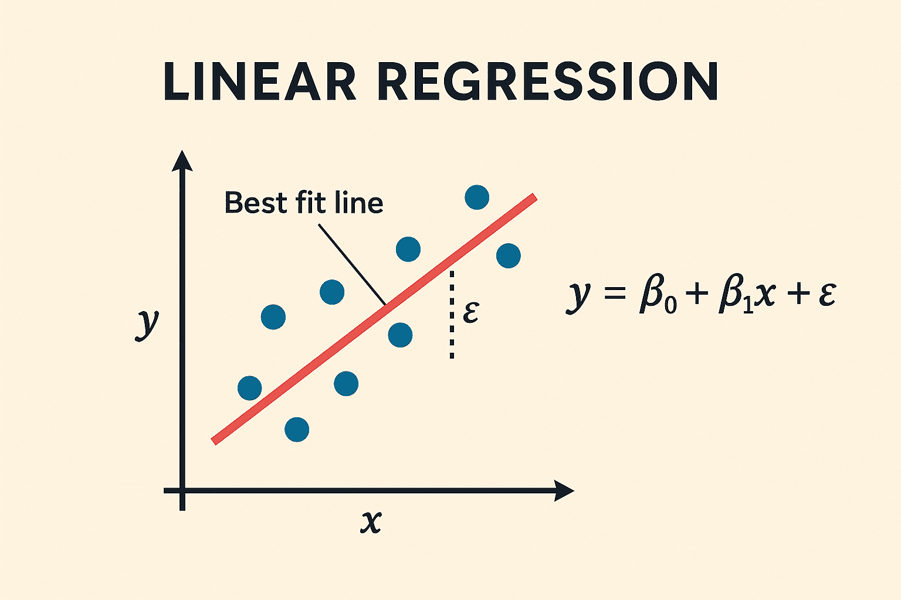

```{python}
#| label: setup
#| echo: false
import pandas as pd, numpy as np, json
import matplotlib.pyplot as plt
import seaborn as sns
from sklearn.model_selection import train_test_split
from sklearn.linear_model import LinearRegression, LogisticRegression
from sklearn.preprocessing import OneHotEncoder
from sklearn.compose import ColumnTransformer
from sklearn.pipeline import Pipeline
from sklearn.metrics import root_mean_squared_error, r2_score, confusion_matrix, accuracy_score
```

## Overview

**Linear regression** predicts a continuous numeric outcome by fitting a straight line (or hyperplane) that minimizes
squared error. Here, it predicts **ROA** from firm characteristics. **Logistic regression** predicts the probability
that an observation belongs to a two-class category. Here, it predicts **P(HighROA = 1)**.

Linear regression outputs any real number and is scored with RMSE and R².

{#fig-linear-concept fig-align="center" width="60%"}

Logistic regression outputs a probability
in [0, 1] and is scored with accuracy and a confusion matrix. Logistic regression computes a linear
score $z = \beta_0 + \beta_1 x_1 + \dots + \beta_k x_k$, then applies the sigmoid $\sigma(z) = \frac{1}{1+e^{-z}}$ to
map $z$ into a probability. A **threshold** (usually 0.5) converts that probability into a class by predicting
1 if $\sigma(z) \ge 0.5$, else 0.

```{python}
#| label: fig-sigmoid
#| fig-cap: "Logistic: The sigmoid maps a linear score z into a probability."
#| fig-width: 6
#| fig-height: 4

z = np.linspace(-8, 8, 400); s = 1/(1+np.exp(-z))
fig, ax = plt.subplots(figsize=(6,4))
ax.plot(z, s, lw=2)
ax.axhline(0.5, color="gray", ls="--"); ax.axvline(0, color="gray", ls=":")
ax.fill_between(z, 0.5, s, where=s>=0.5, alpha=.15, color="green", label="predict 1")
ax.fill_between(z, s, 0.5, where=s<0.5, alpha=.15, color="red",   label="predict 0")
ax.set(title="Sigmoid: z → σ(z)", xlabel="z", ylabel="σ(z)")
ax.legend(); plt.tight_layout(); plt.show()
```

## Data Prep

The dataset is saved as [`data/clean/regression_data.csv`](data/clean/regression_data.csv).
Rows with missing values in any of `Debt_to_Equity`, `Profit_Margin`, `log_Assets`,
`ROA`, or `sector` were dropped before saving.

```{python}
#| label: save-regression-data
#| echo: false

df = pd.read_csv("data/clean/company_financials_clean.csv")
df = df.replace([np.inf, -np.inf], np.nan)
df["log_Assets"] = np.log1p(df["TotalAssets"])
feat_num = ["Debt_to_Equity", "Profit_Margin", "log_Assets"]
df = df.dropna(subset=feat_num + ["ROA","sector"]).copy()
df.to_csv("data/clean/regression_data.csv", index=False)
#print(f"Saved {len(df)} rows to data/clean/regression_data.csv")
```

A sample of the first 10 rows is shown below.

```{python}
#| label: fig-sample-reg
#| fig-cap: "Sample of the modeling data (first 10 rows of regression_data.csv)."
#| echo: false
#| fig-width: 12
#| fig-height: 4.5

_sample = pd.read_csv("data/clean/regression_data.csv").head(10)
fig, ax = plt.subplots(figsize=(18, 4.5))
ax.axis("off")
tbl = ax.table(cellText=_sample.round(3).values,
               colLabels=_sample.columns, loc="center", cellLoc="center")
tbl.auto_set_font_size(False); tbl.set_fontsize(7); tbl.scale(1, 1.4)
plt.tight_layout(); plt.show()
```

The two models need different kinds of label, so `regression_data.csv` carries one column for each.

- **Linear regression:** Return on assets is a continuous ratio (e.g. 0.072 for 7.2%), so it is directly usable as a regression target.
- **Logistic regression:** HighROA = 1 if a company's `ROA` is above the training-set median ROA, and `0` otherwise.
The threshold is computed after the split, from the training rows only.

Both models use the same feature columns: `Debt_to_Equity`, `Profit_Margin`, `log_Assets`, and a one-hot encoded `sector`.

The labeled data is split 80/20 with `random_state=42`, giving roughly 32 training rows and 8 test rows for the 40-row sample.
The two sets are shown side by side below:

```{python}
#| label: fig-split-reg
#| fig-cap: "Training set (left) and testing set (right). Each company-year row appears in exactly one of the two sets — the sets are disjoint."
#| fig-width: 12
#| fig-height: 4.5

df = pd.read_csv("data/clean/regression_data.csv")
train, test = train_test_split(df, test_size=0.2, random_state=42)
thr = train["ROA"].median()
for d in (train, test):
    d["HighROA"] = (d["ROA"] > thr).astype(int)
train.to_csv("data/clean/train_regression.csv", index=False)
test.to_csv("data/clean/test_regression.csv",  index=False)

cols_show = ["ticker","fiscal_year","ROA","Debt_to_Equity","Profit_Margin","log_Assets","HighROA"]
fig, axes = plt.subplots(1, 2, figsize=(12, 4.5))
for ax, d, name in [(axes[0], train, "Training set"), (axes[1], test, "Testing set")]:
    ax.axis("off")
    ax.set_title(f"{name} (n={len(d)})")
    tbl = ax.table(cellText=d[cols_show].head(8).round(3).values,
                   colLabels=cols_show, loc="center", cellLoc="center")
    tbl.auto_set_font_size(False); tbl.set_fontsize(7); tbl.scale(1, 1.4)
plt.tight_layout(); plt.show()
```

The two split files are linked here: [`data/clean/train_regression.csv`](data/clean/train_regression.csv) and [`data/clean/test_regression.csv`](data/clean/test_regression.csv).

`train_test_split` assigns each row to exactly one of the two sets,
so no company-year observation appears in both. They must be disjoint because if a row were in both,
the model could partially memorize it during training.


## Code

The full Python script is saved at [`code/regression_models.py`](code/regression_models.py).

```{python}
#| label: fit-regression-models

train = pd.read_csv("data/clean/train_regression.csv")
test  = pd.read_csv("data/clean/test_regression.csv")

num = ["Debt_to_Equity","Profit_Margin","log_Assets"]
cat = ["sector"]
pre = ColumnTransformer([("num","passthrough",num),
                         ("cat", OneHotEncoder(handle_unknown="ignore"), cat)])

lin = Pipeline([("pre", pre), ("m", LinearRegression())]).fit(train[num+cat], train["ROA"])
pred_lin = lin.predict(test[num+cat])
rmse = root_mean_squared_error(test["ROA"], pred_lin)
r2   = r2_score(test["ROA"], pred_lin)

log = Pipeline([("pre", pre), ("m", LogisticRegression(max_iter=1000))]).fit(train[num+cat], train["HighROA"])
pred_log = log.predict(test[num+cat])
acc = accuracy_score(test["HighROA"], pred_log)
cm  = confusion_matrix(test["HighROA"], pred_log)

names = num + list(lin.named_steps["pre"].named_transformers_["cat"].get_feature_names_out(cat))
coefs_lin = dict(zip(names, lin.named_steps["m"].coef_))
coefs_log = dict(zip(names, log.named_steps["m"].coef_[0]))

#print(f"Linear   RMSE = {rmse:.4f}   R² = {r2:.4f}")
#print(f"Logistic accuracy = {acc:.4f}")
#print("Confusion matrix:\n", cm)
```

## Results

```{python}
#| label: fit-and-score
#| echo: false

train = pd.read_csv("data/clean/train_regression.csv")
test  = pd.read_csv("data/clean/test_regression.csv")

num = ["Debt_to_Equity","Profit_Margin","log_Assets"]
cat = ["sector"]
pre = ColumnTransformer([("num","passthrough",num),
                         ("cat", OneHotEncoder(handle_unknown="ignore"), cat)])

lin = Pipeline([("pre", pre), ("m", LinearRegression())]).fit(train[num+cat], train["ROA"])
pred_lin = lin.predict(test[num+cat])
rmse = root_mean_squared_error(test["ROA"], pred_lin)
r2   = r2_score(test["ROA"], pred_lin)

log = Pipeline([("pre", pre), ("m", LogisticRegression(max_iter=1000))]).fit(train[num+cat], train["HighROA"])
pred_log = log.predict(test[num+cat])
acc = accuracy_score(test["HighROA"], pred_log)
cm  = confusion_matrix(test["HighROA"], pred_log)

names = num + list(lin.named_steps["pre"].named_transformers_["cat"].get_feature_names_out(cat))
coefs_lin = dict(zip(names, lin.named_steps["m"].coef_))
coefs_log = dict(zip(names, log.named_steps["m"].coef_[0]))
```

### Linear regression

- Test RMSE = `{python} f"{rmse:.4f}"`
- Test R² = `{python} f"{r2:.4f}"`
```{python}
#| label: fig-pred-vs-actual
#| fig-cap: "Predicted vs. actual ROA on the test set. Points on the red dashed line are perfect predictions."
#| fig-width: 5
#| fig-height: 5

fig, ax = plt.subplots(figsize=(5,5))
ax.scatter(test["ROA"], pred_lin, s=14, alpha=.6)
lims = [min(test["ROA"].min(), pred_lin.min()), max(test["ROA"].max(), pred_lin.max())]
ax.plot(lims, lims, "r--")
ax.set(xlabel="Actual ROA", ylabel="Predicted ROA",
       title="Linear regression: predicted vs actual")
plt.tight_layout(); plt.show()
```

**Two coefficients in plain words.**

- **`Profit_Margin` (β = `{python} f"{coefs_lin['Profit_Margin']:.4f}"`).** The one coefficient with a real magnitude.
Holding the other features fixed, a company with a profit margin 10 percentage points higher is associated with an ROA
about 3.5 points higher.
- **`Debt_to_Equity` (β = `{python} f"{coefs_lin['Debt_to_Equity']:.4f}"`).** Holding the other features fixed,
a one-unit higher debt-to-equity ratio is associated with an ROA only 0.19 points higher.

### Logistic regression

```{python}
#| label: fig-log-confusion
#| fig-cap: "Confusion matrix for logistic regression on the test set."
#| fig-width: 4
#| fig-height: 3

fig, ax = plt.subplots(figsize=(4,3))
sns.heatmap(cm, annot=True, fmt="d", cmap="Blues", ax=ax,
            xticklabels=["Pred 0","Pred 1"], yticklabels=["True 0","True 1"])
ax.set_title(f"Logistic confusion matrix (acc={acc:.3f})")
plt.tight_layout(); plt.show()
```

- **Test accuracy = `{python} f"{acc:.4f}"`** on `{python} len(test)` test companies.
The model made **0 false positives** but missed half of the true high performers (3 false negatives).
When it calls a firm a top performer it tends to be right, but it under-calls.


Naive Bayes accuracy was **0.75**. It looks like naive bayes performs better than logistic regression
which has an accuracy of **`{python} f"{acc:.4f}"`**.
But with only `{python} len(test)` test rows, both numbers carry wide uncertainty.
Thus, the two models performed *comparably*.

## Conclusions

`Profit_Margin` dominates every other coefficient. In the linear regression,
a company with a profit margin 10 percentage points higher is associated with an ROA about 3.5 points higher
(β = `{python} f"{coefs_lin['Profit_Margin']:.4f}"`). In the logistic regression the same pattern holds:
β = `{python} f"{coefs_log['Profit_Margin']:.4f}"`, so a 10-percentage-point higher margin multiplies the odds of being
a high-ROA firm by about `{python} f"{np.exp(coefs_log['Profit_Margin']*0.10):.3f}"`.

Margin efficiency is the dominant linear driver of financial performance. Also, leverage is not a simple linear warning sign
in this data, and sector adds only marginal signal.